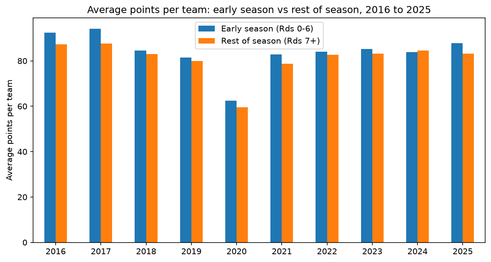

# Does AFL scoring drop after the first six rounds?

An analysis I originally built in R (as part of a Shiny dashboard), reproduced in Python with automated checks that both versions produce the same numbers.

## Question

Does AFL scoring drop after the first six rounds of the home-and-away season, and how consistently has that held from 2016 to 2025?

## Data

- **Source:** [AFL Tables](https://afltables.com), pulled with the [fitzRoy](https://github.com/jimmyday12/fitzRoy) R package (`r/fetch_afl_data.R`)
- **Coverage:** home-and-away matches, 2016 to 2025; finals excluded
- **Grain:** one row per match (`data/afl_match_data.csv`)
- **Early season:** Rounds 0 to 6. From 2024 the partial Opening Round is recoded as Round 0, so the early window covers the same part of the season in every year.

## Method

1. Classify every match as early season (Rounds 0 to 6) or rest of season (Rounds 7+)
2. **Result 1:** average points per team in each phase for every season, the drop between them, and whether early scoring was higher
3. **Result 2:** a full early vs rest comparison for 2025: games, average team score, average combined score, average winning margin, % of games with a 100+ score, and highest combined score
4. Check both results against CSVs exported from the original R code (`r/export_results.R`) using `pandas.testing.assert_frame_equal`

## Results

**Early-season scoring was higher than the rest of the season in 9 of 10 seasons.** The exception was 2024.

**2025 followed the pattern on every scoring measure.** Teams averaged 87.7 points in Rounds 0 to 6 against 83.1 for the rest of the season. Combined scores, winning margins, the share of 100+ scores and the highest combined score were all higher early.



**Python matched R on both results** to a relative tolerance of 1e-6.

## Where R and Python differed

- **Conditional columns.** `mutate(phase = ifelse(...))` became `assign(phase = lambda d: np.where(...))`. `assign` with a lambda is the closest pandas equivalent of a dplyr pipe step.
- **Reshaping.** `pivot_wider(names_prefix = "avg_")` has no one-line equivalent. I used `pivot_table()` and then renamed the columns with a list comprehension. Note that `pivot_table()` silently averages any duplicate cells, whereas `pivot()` raises an error, which is the safer default.
- **Counting and conditional means.** `n()` became a named aggregation on any column with `"count"`. The share of 100+ games, a one-liner inside dplyr's `summarise()`, needed a lambda that reached back into the full DataFrame. Creating a `has_100_plus` column before grouping would be cleaner.
- **Readability.** dplyr reads more naturally for multi-step transformations. Method chaining with `assign()` gets close, and I expect it to feel more natural with practice.

## Limitations

This is descriptive. It shows a consistent pattern but does not test whether the gap is statistically significant, or separate the likely causes (weather, fatigue, maturing defensive structures). 2020 is included, but it was played with shortened quarters, so its absolute scores are not comparable with other seasons; the within-season comparison still holds.

## Run it

```bash
git clone git@github.com:benlenep/afl-early-season-scoring-r-to-python.git
cd afl-early-season-scoring-r-to-python
uv sync
```

Then open `analysis.ipynb` in VS Code and select the project's `.venv` kernel. To regenerate the R outputs, run `Rscript r/export_results.R` from the repository root.

## Files

```text
analysis.ipynb          the Python analysis
r/fetch_afl_data.R      pulls the match data from AFL Tables via fitzRoy
r/export_results.R      the original R calculations, exported for the parity checks
data/                   match data used by both versions
r_outputs/              results exported from R
chart_1.png             the chart above
```